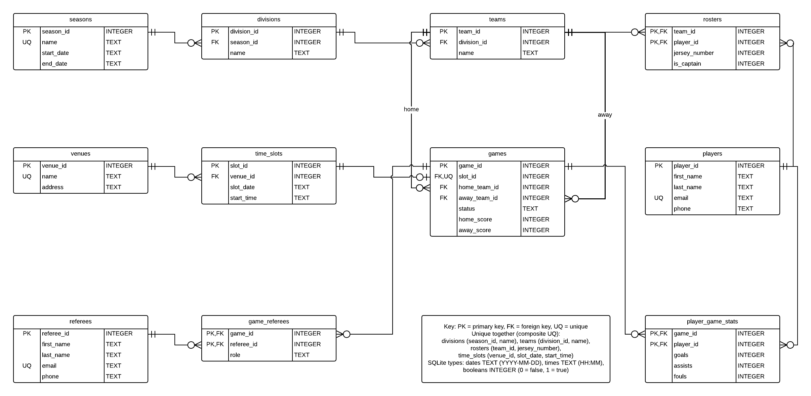

# Rec League Manager

A database application for running a recreational soccer league, like a city or campus league.
It keeps seasons, teams, rosters, the game schedule, venues, referees, and game results in one
SQLite database. Python and Flask provide a web front end for it.

## Contents

- [Project Overview](#project-overview)
- [DBMS](#dbms)
- [Repository Files](#repository-files)
- [ER Diagram](#er-diagram)
- [Database Setup](#database-setup)
- [Application Setup](#application-setup)
- [Major Application Operations](#major-application-operations)
- [Demo Walkthrough](#demo-walkthrough)
- [How the Application Uses the Database](#how-the-application-uses-the-database)
- [Known Limitations](#known-limitations)
- [Changes Since Earlier Deliverables](#changes-since-earlier-deliverables)
- [Security](#security)
- [Troubleshooting](#troubleshooting)

---

## Project Overview

**What it does.** A lot of rec leagues run on spreadsheets and group chats. That makes it hard to
keep rosters current, avoid booking two games at the same field and time, and keep standings
right. Rec League Manager puts all of it in one database. It tracks seasons, divisions, teams,
players and rosters, venues and their bookable time slots, the game schedule, referee
assignments, final scores, and each player's goals, assists, and fouls per game. Standings and
scoring leaders are calculated from game results, so they can't drift out of sync.

**Intended users.**

| User | What they use it for |
|---|---|
| League admins | Schedule, reschedule, and cancel games, assign referees, check standings |
| Team captains | Manage the roster and jersey numbers, check the schedule and standings |
| Players | Look up their teams, schedule, standings, and their own stats |
| Referees | See their games and enter final scores and player stats |

The app has no logins (left out of scope in the proposal), so every page is open to whoever
runs it.

**Major functionality.**

- Search and browse players, teams, and games
- View a team's roster together with its full schedule and results
- Add players to rosters, enforcing jersey number, captain, and one-team-per-division rules
- Schedule games into open time slots without double booking a venue, a team, a player, or a referee
- Reschedule or cancel games
- Assign center and assistant referees
- Enter a final score and every player's stats as one all-or-nothing transaction
- Season reports: summary totals, division standings (from a view), and top scorers

---

## DBMS

**SQLite 3.** The whole database is one file (`rec_league.db`) built from the SQL files in this
repository. There is no hosted service, server, or account to set up.

- The app uses Python's built-in `sqlite3` module, so nothing extra is needed to build or use the database from Python.
- The `sqlite3` command line tool is only needed to run `queries.sql`, `transaction.sql`, and `run_queries.sh` directly.
- Tested with SQLite 3.45 (command line), Python 3.13, Flask 3.1.3, and python-dotenv 1.2.4.

---

## Repository Files

| File | Purpose |
|---|---|
| `README.md` | This file: setup, run, and demo instructions |
| `erd.png` | Final ER diagram (11 tables) |
| **Database** | |
| `schema.sql` | Creates all 11 tables with keys and constraints, the `division_standings` view, and the `idx_time_slots_date` index. Safe to rerun, since it drops everything first |
| `insert_data.sql` | Sample data: 4 seasons, 39 players, 21 games and more, 338 rows in total |
| `queries.sql` | Nine labeled queries (filtering, joins, aggregates, GROUP BY/HAVING, subquery, EXCEPT, view) |
| `transaction.sql` | Transaction example: enters a final score and player stats, shows the effect, then rolls back |
| `run_queries.sh` | Bash script that rebuilds the database and runs `queries.sql` and `transaction.sql` |
| **Application** | |
| `app.py` | Flask web pages (routes), league rule checks, and error pages |
| `queries.py` | All of the app's SQL, every user value passed as a `?` parameter |
| `db.py` | Opens and closes connections, turns on foreign keys, runs transactions |
| `validators.py` | Checks typed input (whole numbers, ranges, required fields) |
| `config.py` | Database path, port, and optional `.env` settings |
| `init_db.py` | Builds `rec_league.db` from `schema.sql` and `insert_data.sql` |
| `templates/` | HTML pages (Jinja templates) |
| `requirements.txt` | Python packages: Flask and python-dotenv |
| **Configuration** | |
| `.env.example` | Template for optional settings. Contains no secrets |
| `.gitignore` | Keeps `.env`, `*.db`, `.venv/`, and `__pycache__/` out of the repository |
| `.gitattributes` | Keeps `run_queries.sh` with LF line endings so it runs after a Windows clone |

---

## ER Diagram



Key: PK = primary key, FK = foreign key, UQ = unique. Crow's foot notation.

**How the design fits together**

- **League structure:** `seasons` 1:M `divisions` 1:M `teams`. A team row is a team *in one season*, so next season's team with the same name is a new row.
- **Players and teams (many-to-many):** `rosters` links them and stores `jersey_number` and `is_captain`. Composite PK (`team_id`, `player_id`), and `UNIQUE (team_id, jersey_number)` stops two players on one team from wearing the same number.
- **Scheduling:** `venues` 1:M `time_slots`. Each game uses exactly one slot, and `games.slot_id` is `UNIQUE`, so one slot can only hold one game. Open slots are just slots with no game. `UNIQUE (venue_id, slot_date, start_time)` stops the same slot from being entered twice.
- **Home and away:** `games` references `teams` twice (`home_team_id`, `away_team_id`), and a CHECK stops a team from playing itself.
- **Referees and games (many-to-many):** `game_referees` stores each referee's `role` (center or assistant). `ON DELETE CASCADE` removes assignments when a game is cancelled.
- **Stats:** `player_game_stats` holds one player's goals, assists, and fouls for one game (composite PK `game_id`, `player_id`).
- **View:** `division_standings` turns completed games into wins, losses, ties, goal difference, and points (3 for a win, 1 for a tie). Standings are calculated, never stored.
- **Index:** `idx_time_slots_date` on `time_slots(slot_date)` speeds up "which slots are booked or open this week" across all venues.

---

## Database Setup

### Required software

| To do this | You need |
|---|---|
| Build the database for the app (Option A) | Python 3.9 or newer, nothing else |
| Run the SQL files directly (Option B) | The `sqlite3` command line tool |

Installing the `sqlite3` command line tool:

- **WSL / Ubuntu:** `sudo apt update && sudo apt install sqlite3`
- **macOS:** already installed
- **Windows (PowerShell):** download the "sqlite-tools" zip for Windows from <https://www.sqlite.org/download.html>, unzip it, and either add that folder to your PATH or run `sqlite3.exe` by its full path. Using WSL also works.

### Order the SQL files run in

1. `schema.sql` creates the tables, view, and index
2. `insert_data.sql` loads the sample data
3. `queries.sql` runs the nine queries (read only)
4. `transaction.sql` runs the transaction example (it ends with `ROLLBACK`, so the data is unchanged afterward)

### Option A: build the database with Python (what the app uses)

From the project folder:

```bash
python init_db.py          # Windows
python3 init_db.py         # WSL, Linux, macOS
```

Expected output ends with `338 rows in 11 tables.` This runs `schema.sql` then `insert_data.sql`
and creates `rec_league.db` in the project folder. Running it again resets the data.

### Option B: run the SQL files with the sqlite3 command line

**WSL, Linux, or macOS, all in one step:**

```bash
bash run_queries.sh
```

This deletes and rebuilds `rec_league.db`, loads the data, runs all nine queries (each printed
under its `-- Requirement` comment), runs the transaction, and ends with
`Transaction completed successfully.` and `Done.`

**Any shell, including Windows PowerShell, one file at a time:**

```bash
sqlite3 -bail rec_league.db ".read schema.sql"
sqlite3 -bail rec_league.db ".read insert_data.sql"
sqlite3 -header -column rec_league.db ".read queries.sql"
sqlite3 -bail -header -column rec_league.db ".read transaction.sql"
```

Use `.read` like this in PowerShell, because PowerShell doesn't support `< file` input redirection.

### Expected results

| Query | Result with the sample data |
|---|---|
| Req 1: players with no phone number | 5 players |
| Req 2: Riverside Rovers Fall roster (INNER JOIN) | 5 players, captain first |
| Req 3: booked and open slots, week of Oct 25 (LEFT JOIN) | 3 booked, 1 open |
| Req 4: Northside United schedule (three-table join) | Loss, Win, Tie, then 2 upcoming |
| Req 5: Fall 2026 summary (aggregates) | 9 games, 35 goals, 3.89 per game, most in one game 5 |
| Req 6: top scorers with 3+ goals (GROUP BY / HAVING) | 4 players |
| Req 7: upcoming games with no referee (subquery) | 3 games |
| Req 8: Summer players not on a Fall team (EXCEPT) | 4 players |
| Req 9: Fall standings (view) | 7 teams |

**Transaction:** game 16 (Northside United vs Riverside Rovers) is marked completed 3 to 1 and 10
stat rows are inserted. Inside the transaction, Northside United goes from 4 to 7 points. After
`ROLLBACK`, game 16 is scheduled again with no stat rows and the standings match the "before"
results.

### SQLite-specific notes

- **Foreign keys:** SQLite ignores foreign keys unless `PRAGMA foreign_keys = ON;` is set for each connection. The SQL files start with it, and the app turns it on for every connection in `db.py`.
- **Types:** dates are `TEXT` in `YYYY-MM-DD`, times are `TEXT` in `HH:MM` (24 hour), and true/false values are `INTEGER` 0 or 1. CHECK constraints reject anything not in those formats.
- **`-bail` for the transaction:** if a statement fails inside a transaction, SQLite only undoes that statement and keeps going. `-bail` stops at the first error, so the unfinished transaction is rolled back instead of half committed. `run_queries.sh` and the commands above use it.
- **No configuration:** SQLite has no server, username, or password, so there are no connection settings or credentials.

---

## Application Setup

**Language:** Python 3.9 or newer. **Framework:** Flask 3. **Packages:** `Flask` and
`python-dotenv` (listed in `requirements.txt`). The app is a web front end and Python back end in
one program: browser → Flask app → `rec_league.db`.

Open a terminal in the project folder. Steps 1 and 2 only need to be done once.

### Windows (PowerShell)

```powershell
# 1. Create and activate a virtual environment
py -m venv .venv
.venv\Scripts\Activate.ps1
#    If PowerShell says running scripts is disabled, run this, then activate again:
#    Set-ExecutionPolicy -Scope Process -ExecutionPolicy Bypass

# 2. Install the packages
pip install -r requirements.txt

# 3. Build the database
python init_db.py

# 4. Start the app
python app.py
```

If `py` isn't found, install Python from <https://www.python.org/downloads/> (tick "Add python.exe to PATH") or use `python -m venv .venv` in step 1.

### WSL, Linux, or macOS

```bash
# 1. Create and activate a virtual environment
python3 -m venv .venv
source .venv/bin/activate
#    On Ubuntu or WSL, if venv is missing: sudo apt install python3-venv python3-pip

# 2. Install the packages
pip install -r requirements.txt

# 3. Build the database
python3 init_db.py

# 4. Start the app
python3 app.py
```

### Open the app

Step 4 prints:

```
Rec League Manager is running. Open http://127.0.0.1:5050 in your browser.
```

Open <http://127.0.0.1:5050>. Press `Ctrl+C` in the terminal to stop the app. Next time, just
activate the virtual environment (second line of step 1) and run step 4.

### Database connection and configuration

No configuration is required. By default the app connects to `rec_league.db` in the project
folder, found relative to `app.py`, so it works no matter which folder you start it from. If the
database file is missing, `app.py` stops and tells you to run `init_db.py`.

Optional settings can be changed with a `.env` file or environment variables:

1. Copy the template: `Copy-Item .env.example .env` (PowerShell) or `cp .env.example .env` (Bash)
2. Edit the values in `.env`

| Setting | Default | What it does |
|---|---|---|
| `REC_LEAGUE_DB` | `rec_league.db` | Database file used by the app and `init_db.py` (relative paths start in the project folder) |
| `PORT` | `5050` | Port the app listens on |
| `SECRET_KEY` | blank (random at each start) | Signs the short messages shown after a form is saved |

Values set in the terminal win over `.env`, for example `$env:PORT = "8080"; python app.py`
(PowerShell) or `PORT=8080 python3 app.py` (Bash). `.env` is in `.gitignore`, so local settings
are never committed.

---

## Major Application Operations

The menu on every page has **Players, Teams, Games, Reports,** and **Schedule a game**.

| Operation | Where | Database work |
|---|---|---|
| Search players | Players, type part of a name or email | `SELECT ... WHERE ... LIKE ?` with `%` and `_` escaped |
| Team roster and schedule (related data) | Teams, click a team | `rosters` joined to `players`, and `games` joined to `time_slots`, `venues`, and `teams` |
| Add a player to a roster | Team page, "Add player to roster" | `INSERT INTO rosters` |
| Reschedule a game | Upcoming game, "Reschedule or cancel" | `UPDATE games SET slot_id = ?` |
| Cancel a game | Upcoming game, "Reschedule or cancel", tick the box | `DELETE FROM games` (referee rows cascade, the slot becomes open) |
| Enter final score and player stats | Upcoming game, "Enter final score" | One transaction: `UPDATE games` plus an `INSERT` into `player_game_stats` for each player who played |
| Season report | Reports | Summary with `COUNT`/`SUM`/`AVG`, standings from the `division_standings` view, top scorers with `GROUP BY`/`HAVING` |
| Schedule a new game | Schedule a game | `INSERT INTO games` into an open slot |
| Assign a referee | Form on an upcoming game's page | `INSERT INTO game_referees` |
| Games that need a referee | Games, tick "Only upcoming games with no referee" | Filter on games with no `game_referees` rows |

Rules checked before saving, each with a plain message when broken: jersey number already taken on
the team, a second captain, a player already on another team in the same division, a slot that is
booked or outside the season, a team, player, or referee who already has a game at that time, two
teams from different divisions, a second center referee, player goals that don't add up to the
score, and letters, decimals, negatives, or blanks in number fields.

---

## Demo Walkthrough

These steps use the sample data. Run `python init_db.py` first so the IDs and results match.

| Step | Do this | You should see |
|---|---|---|
| Search | Players, search `chen` | Matching players. Click one to see their teams and stats |
| Related data | Teams, Fall 2026, Northside United | Roster, then results Loss, Win, Tie, and 2 upcoming games |
| Add | Teams, pick Winter 2027, Riverside Rovers, "Add player to roster". Mason Reed, jersey 8, tick captain | Mason Reed on the roster as captain |
| Invalid add | Same team: Ava Torres with jersey 8, then Ava Torres as captain | Both rejected with a message, nothing saved |
| Update | Games, game 16, "Reschedule or cancel", pick Sat Nov 7 09:00 Riverside Park | Game 16 moves to Nov 7 |
| Delete | Games, game 17, "Reschedule or cancel", tick the box, "Cancel game" | Game 17 is gone and its Oct 24 slot is open again |
| Transaction | Games, game 20, "Enter final score". Northside United 2, Lakeview FC 1. Jamal Turner 1 goal, Isaac Walsh 1 goal, Mateo Garcia 1 goal | Game 20 shows as completed 2 to 1, with every player's line under "Player stats" |
| Invalid transaction | Try it with goals that don't add up to the score | Rejected, nothing saved, game stays upcoming |
| Report | Reports, Fall 2026, change "at least" to 3 | Standings now include game 20 (Northside United has 7 points). 6 top scorers are listed. Before game 20 there were 4, and Jamal Turner and Isaac Walsh reach 3 goals with their game 20 goals |
| Extras | Game 18, assign Mike Sullivan as center. Schedule a game: Northside United vs Old City Athletic, Sat Nov 7 10:30 | Referee listed on game 18, new game on the schedule |

### Showing that changes are stored in the database

After the "Add" step, check the database file directly from a second terminal (the app can stay running):

```bash
sqlite3 rec_league.db "SELECT * FROM rosters WHERE team_id = 11;"
```

Without the sqlite3 tool (works in PowerShell too):

```powershell
python -c "import sqlite3; print(sqlite3.connect('rec_league.db').execute('SELECT * FROM rosters WHERE team_id = 11').fetchall())"
```

The first prints `11|38|8|1` and the second prints `[(11, 38, 8, 1)]`: team 11, player 38 (Mason
Reed), jersey 8, captain. The same works for the other steps, for example
`SELECT status, home_score, away_score FROM games WHERE game_id = 20;`. Stopping and restarting
the app also keeps every change, since each one is saved to `rec_league.db` when the form is
submitted.

To reset everything back to the sample data, stop the app and run `python init_db.py` again.

---

## How the Application Uses the Database

- **Safe SQL:** every value from the user is passed as a `?` parameter, for example `conn.execute("SELECT ... WHERE team_id = ?", (team_id,))`. No SQL is built by pasting input into a string, so input is always treated as data, never as SQL. Search text also escapes `%` and `_` so they match literally.
- **All SQL in one place:** `queries.py`. Filtering, joins, totals, and grouping happen in SQL, not by loading whole tables into Python.
- **Connections:** each page request opens one connection, turns on `PRAGMA foreign_keys`, and closes it when the request ends (`db.py`).
- **Transaction:** entering a final score runs inside `BEGIN IMMEDIATE ... COMMIT`. Any error rolls back the score update and every stat insert together. The `UPDATE` only matches a game that is still scheduled, so the same result can't be entered twice.
- **Single-statement changes** (add to roster, reschedule, cancel, schedule, assign referee) save on their own. Cancel is one `DELETE`, and the cascade happens inside it.
- **Invalid operations:** the app checks the league rules first so it can show a clear message. The schema's constraints (UNIQUE slot per game, unique jersey per team, CHECKs, foreign keys) are the final safety net, and any constraint error is turned into a plain message instead of a raw database error. Missing pages return a 404 page, and unexpected database errors are logged to the terminal, never shown as a stack trace.
- **Stable results:** pages pick the default season from the data (the latest season with games, Fall 2026), not today's date, so the app shows the same thing whenever it's run.

---

## Known Limitations

- **No logins or roles.** Anyone who can open the app can make any change. Logins, payments, and notifications were left out of scope in the proposal.
- **Local only.** The app runs on Flask's built-in development server and only listens on `127.0.0.1`. It isn't set up for deployment to a public server.
- **No pages for setup data.** Seasons, divisions, teams, players, venues, time slots, and referees come from `insert_data.sql`. The app has no pages to create them, so proposal operation 2 (create a new team) is not in the app.
- **Results can't be edited.** Once a final score is entered, it can't be corrected or undone in the app. Rebuilding the database resets it.
- **Cancelled games are deleted**, so the app keeps no record of cancellations.
- **Some rules are app-level only.** One team per player per division, one captain per team, one center referee per game, same-division matchups, no time conflicts for teams, players, or referees, and goals matching the score are checked by the app, not by the schema. Changes made directly with SQL could break them. The rules the schema itself enforces are listed in `schema.sql`.
- **Season of a game** comes from the home team's division, since `games` has no season column. This works because the app only schedules games between teams in the same division.
- **Goals per game** counts only games where a player has a stat row. The app adds a row for every player marked as played.
- **One writer at a time.** SQLite handles one write at a time, which is fine for a small league but not for heavy multi-user use.
- **Rebuilding erases app changes.** `init_db.py` and `run_queries.sh` both rebuild the same `rec_league.db`. Stop the app before rebuilding.

There are no known bugs. Every step in the Database Setup, Application Setup, and Demo Walkthrough
sections was tested from a fresh copy of this repository.

---

## Changes Since Earlier Deliverables

- **ER diagram:** now marks every unique constraint in the schema (UQ on `seasons.name`, `venues.name`, `players.email`, `referees.email`, plus the four composite unique rules in the legend). The tables, columns, keys, and relationships are unchanged.
- **Configuration:** added `.env.example` and optional `.env` support (`python-dotenv`) for the database path, port, and secret key. The defaults are the same as before.
- **Repository files:** `README.md` replaces the earlier `README.txt` files. Added `.gitignore` and `.gitattributes`.
- **No changes** to `schema.sql`, `insert_data.sql`, `queries.sql`, `transaction.sql`, `run_queries.sh`, or how the app behaves.

---

## Security

- The repository contains no passwords, API keys, private keys, service-role keys, or connection strings. SQLite has no credentials.
- `.env.example` only lists setting names with safe defaults. `SECRET_KEY` is blank, and the app makes a random one when it starts.
- `.env`, the database file, and the virtual environment are in `.gitignore`.
- The app only accepts connections from the same computer (`127.0.0.1`).

---

## Troubleshooting

| Problem | Fix |
|---|---|
| "No database found" when starting the app | Run `python init_db.py` |
| `py` not found (Windows) | Install Python from python.org, or use `python` instead of `py` |
| `python` not found (WSL, macOS) | Use `python3`. Inside the activated `.venv` either works |
| `ModuleNotFoundError: No module named 'flask'` | Activate the virtual environment, then `pip install -r requirements.txt` |
| "Address already in use" | Another program has port 5050. Set `PORT` (see configuration above) |
| "database is locked" while running `init_db.py` | Stop the app with `Ctrl+C` first, then run it again |
| `sqlite3: command not found` | Install the sqlite3 tool (see Database Setup), or use Option A |
| `run_queries.sh` fails with `$'\r': command not found` | The file got Windows line endings. Run `sed -i 's/\r$//' run_queries.sh`, then try again |
